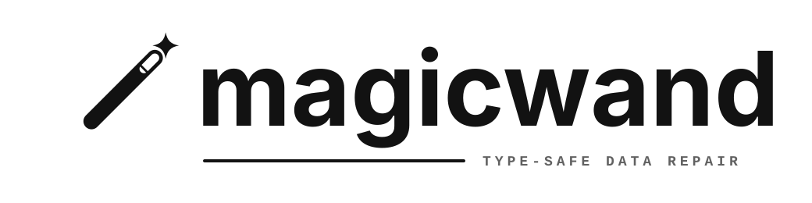

<p align="center">
  
</p>

<p align="center">
  Immutable, type-safe transformations for data at the edge of your application.
</p>

<p align="center">
  <a href="#install">Install</a> ·
  <a href="#example">Example</a> ·
  <a href="#model">Model</a>
</p>

## Install

```sh
npm install wandofmagic
```

## Example

```ts
import { spell } from 'wandofmagic';
import { number } from 'wandofmagic/coerce';

type WireUser = {
  age?: string;
  first_name: string;
  password_hash: string;
};

const normalizeUser = spell<WireUser>()
  .rename({
    first_name: 'firstName',
    password_hash: 'passwordHash',
  })
  .trim(['firstName'])
  .coerce('age', number({ integer: true }), { missing: 'skip' })
  .omit(['passwordHash'])
  .build();

const result = normalizeUser.safeRun({
  age: '37',
  first_name: '  Ada  ',
  password_hash: 'private',
});

if (result.ok) {
  result.value; // { age?: number; firstName: string }
  result.changes; // what changed, never field values
} else {
  result.issues; // stable codes, paths, and step metadata
}
```

## Model

A spell is an immutable repair plan. Its output type evolves as fields are renamed, coerced,
created, moved, and removed. Build it once, then run it anywhere the same boundary shape appears.

Checked execution is the default. Trusted execution and auditable generated mappers are explicit
opt-ins for inputs whose shape is already established.

## License

[MIT](LICENSE)
